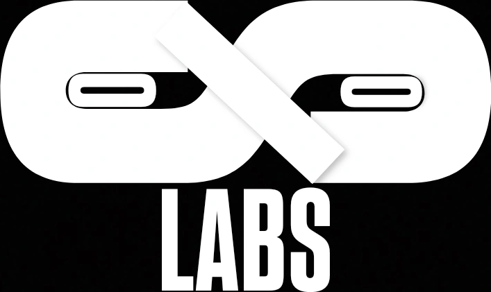

  

<h1 align="center">Olos Labs</h1>

  An independent technology lab engineering autonomous systems, security tooling, and digital infrastructure.

  <a href="https://oloslabs.com">Website</a> ·
  <a href="https://x.com/oloslabs">X</a> ·
  <a href="https://t.me/oloslabs">Telegram</a> ·
  <a href="mailto:contact@oloslabs.com">Contact</a>

---

> Olos Labs builds focused software, automation that keeps running, and the security and infrastructure underneath both. Every product ships under its own name, on a shared foundation.

## Focus areas

| Products & Platforms | Autonomous Systems | Security & Infrastructure |
|---|---|---|
| Web applications Standalone utilities Developer-facing software | Background execution engines Intelligent automation pipelines Resilient backend daemons | Offensive and defensive systems research Vulnerability assessment Smart-contract auditing Distributed node management |

## How we work

- **Independent products.** Each initiative ships under its own identity, product brand, and repository, with no artificial naming constraints.
- **One foundation.** Systems share deployment standards, security baselines, and core infrastructure pipelines.
- **Built for continuous operation.** Autonomous systems are designed to run, recover, and keep running.
- **Traceable lineage.** Shipped products carry the notice `Copyright (c) 2026 Olos Labs`.

## Projects

Products are released as separate repositories under this organization. Browse them in [repositories](https://github.com/orgs/OlosLabs/repositories).

<!--
When the first projects are public, replace the paragraph above with a table:

| Project | Area | Description |
|---|---|---|
| [name](https://github.com/OlosLabs/name) | Autonomous Systems | One-line description |
-->

## Security and contact

- **Vulnerability reports and security inquiries:** [contact@oloslabs.com](mailto:contact@oloslabs.com)
- **Collaboration and other inquiries:** [contact@oloslabs.com](mailto:contact@oloslabs.com)

## About

Olos Labs started as a one-person lab and was going to be called Solo Labs. `sololabs.com` was taken, so Solo became Olos: just Solo, backwards. The full story, including the idea behind the logo, is at [oloslabs.com](https://oloslabs.com).

---

  Copyright (c) 2026 Olos Labs · Indonesia

